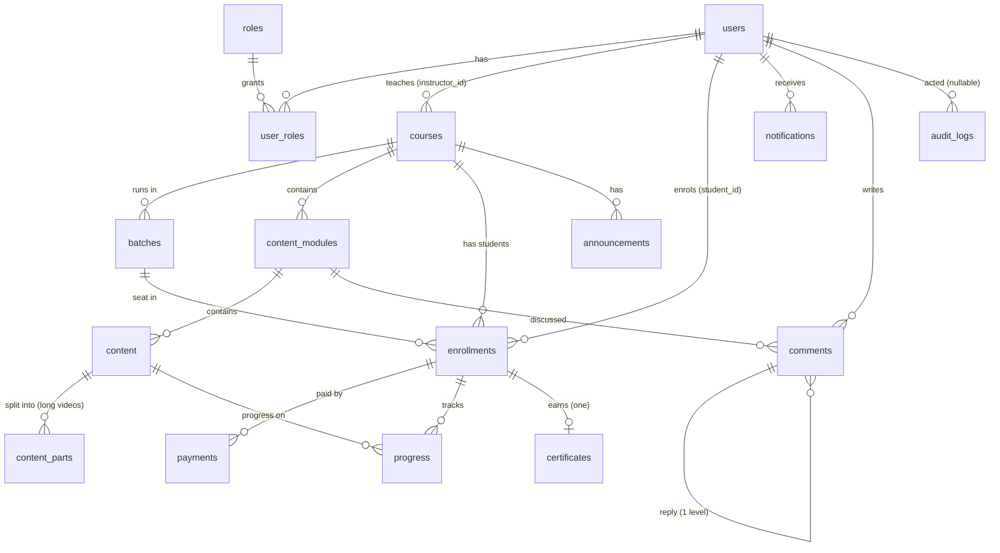

# EduStream database

PostgreSQL 14+ (developed and tested on 16). The schema, business rules (functions), triggers and views live here;
the API calls the `fn_*` functions for anything that must be atomic or must not be trusted to the client.

## Files

| File | What it is |
|---|---|
| `schema.sql` | Types, tables, constraints, indexes. Always the **current** schema (it already contains every migration). |
| `functions.sql` | `fn_*` business functions (register, enroll, pay, refund, course lifecycle, admin, anonymise...). |
| `triggers.sql` | Seat counting, enrollment checks, certificate issue, comment depth, `updated_at`. |
| `views.sql` | `vw_*` views used by analytics and the dashboards. |
| `seed/base_seed.sql` | Demo roles, users, courses, batches. |
| `seed/python_course.sql` | Optional large demo course (52 lessons). |
| `migrations/NNN_*.sql` | Changes for databases that already exist (see below). |
| `elearning_full_setup.sql` | **Generated** single script with everything. Never edit it by hand. |
| `build-full-setup.mjs` | Generates the full script from the pieces; `--check` fails when it is out of date (CI runs it). |
| `00_create_db.sql` | `CREATE DATABASE elearning_db`. |

## Setup

Use the runner in `../server/scripts/db.mjs` (it reads `DATABASE_URL` from the environment or `server/.env`):

```bash
cd server
node scripts/db.mjs setup --seed            # fresh, empty database: schema + functions + triggers + views + demo data
node scripts/db.mjs setup --seed --python   # ... plus the Python demo course
node scripts/db.mjs setup --reset --seed    # development only: DROP SCHEMA public CASCADE, then set up again
node scripts/db.mjs status                  # which migrations are applied / PENDING
node scripts/db.mjs migrate                 # apply pending migrations to an existing database
node scripts/db.mjs init                    # containers: set up if empty, otherwise migrate (seeds only if SEED_DEMO_DATA=true)
```

* A fresh `setup` records every migration as applied, because `schema.sql` already contains them.
* `--seed` and `--reset` are **refused when `NODE_ENV=production`** (the seed users share a known password) unless
  `ALLOW_SEED_IN_PRODUCTION=1` is set on purpose.
* Without the runner, `psql -U postgres -f elearning_full_setup.sql` runs the same thing in one go.

### Upgrading a database created before the runner existed

If the database already matches migration 007 (it was built from the older files and migrations 001-007 were run):

```bash
cd server
node scripts/db.mjs baseline --through 007    # record 001-007 as applied, changes nothing
node scripts/db.mjs migrate                   # applies 008, 009, ...
```

### Changing the schema (workflow)

1. Edit `schema.sql` and/or `functions.sql` / `triggers.sql` / `views.sql` (these describe a *fresh* database).
2. Add `migrations/NNN_description.sql` that brings an *existing* database to the same state (wrap it in
   `BEGIN; ... COMMIT;`, make it safe to re-run where you can).
3. `node database/build-full-setup.mjs` to regenerate `elearning_full_setup.sql`.
4. Run the server tests (they rebuild a throw-away database from these files) and `node scripts/db.mjs migrate`
   against a database from the previous version to prove the migration works.

## Seed logins

All seed users use the password `Password123!`.

| Email | Role |
|---|---|
| admin@elearning.com | Admin |
| john.doe@elearning.com, sarah.smith@elearning.com | Instructor (approved) |
| alice@student.com, bob@student.com | Student |

Seed courses: 1 Full-Stack (paid), 2 DSA (paid), 3 Git (**free**), 4 System Design (**draft**, not in the catalog).

## Data model



Delete rules worth knowing: `courses.instructor_id`, `enrollments.student_id / course_id`, `payments`, `certificates`
and `announcements.author_id` are `RESTRICT`, so a user is never hard-deleted. `fn_anonymise_user` (admin
`DELETE /admin/users/:id`) removes everything that identifies a person and keeps the rows others point at.
Deleting a course cascades to its modules, content and batches, and is refused once anyone has enrolled.

### Enum types

`user_status_enum` (active / inactive / banned), `course_status_enum` (draft / published / archived),
`batch_status_enum` (open / full / closed), `content_type_enum` (video / pdf / text), `content_status_enum`
(uploading / processing / ready / error), `enrollment_status_enum` (pending / active / completed / dropped),
`payment_status_enum` (pending / success / failed / refunded), `payment_method_enum`, `notification_type_enum`,
`audit_action_enum` (INSERT / UPDATE / DELETE).

## Business rules enforced in the database

| Rule | Where |
|---|---|
| Only `student` / `instructor` can self-register; instructors start `pending` until an admin approves them | `fn_register_user` |
| One live enrollment per student and course (dropped ones do not count); the batch must belong to the course | unique index + composite FK |
| Seats: `batches.current_capacity` follows enrollments; a full batch cannot be joined | triggers T-01..T-03, `fn_enroll_student` |
| A paid enrollment stays `pending` until payment; unpaid ones expire and free their seat | `fn_confirm_payment`, `fn_expire_pending_enrollments` |
| At most one `success` payment per enrollment | partial unique index |
| Refunds: full only, never for a completed course | `fn_get_refund_target`, `fn_mark_payment_refunded` |
| A lesson counts as done at 80 % watched; progress needs an active / completed enrollment | `fn_upsert_progress` |
| Comments: same module as the parent, one level deep | trigger T-06 |
| Course edit / publish / archive rules (price locks once students enrol, publish needs a ready lesson and an open batch, archived courses are read-only) | `fn_update_course`, `fn_set_course_status` |
| Module order can swap inside one transaction | deferrable `uq_module_seq`, `fn_reorder_modules` |

Errors raised with `P0001` (rule violated), `P0002` (not found), `23505` (duplicate) and `42501` (not allowed) are mapped
by the API to 400/409, 404, 409 and 403.

## Certificate policy

A certificate is issued **when the last required lesson of an `active` enrollment is marked complete**: trigger
`trg_progress_check_completion` compares the lessons the student completed with all `ready` lessons of the course,
then inserts the certificate (one per enrollment, race-safe) and sets the enrollment to `completed`.

**Decision: completed enrollments are NOT reopened.** If an instructor adds a lesson after a student has
completed the course, that student keeps the certificate and the `completed` status; the new lesson is simply
available to them. The trigger only looks at `active` enrollments, so nothing re-evaluates a completed one. Students who
are still `active` need the new lesson as well, because the completion check counts every `ready` lesson at
the moment they finish their last one.

Known limitation (reproduced by hand in psql on the seed data; no automated test): the check runs only when a student completes a lesson.
If an instructor *deletes* the one lesson an `active` student had left, nothing fires, so that student is not
certificated until some other progress event happens, and since they have no lessons left to complete it may never happen.
An admin can fix such a case by hand; re-evaluating on content deletion is a candidate for a later step.

## Migrations

| File | What it does |
|---|---|
| `001_content_text_body.sql` | `content.text_body` + a check so `type = 'text'` lessons have text (P0-2) |
| `002_admin_user_management.sql` | `fn_list_users`, `fn_set_user_status` (admin user list, activate / deactivate / ban; P0-5) |
| `003_course_lifecycle.sql` | `fn_update_course`, `fn_set_course_status` (edit, publish checklist, unpublish / archive; P0-7) |
| `004_module_batch_course_delete.sql` | deferrable `uq_module_seq`; `fn_update_module`, `fn_reorder_modules`, `fn_update_batch` (P0-7) |
| `005_roles_instructor_approval.sql` | `users.instructor_status`; `fn_set_user_role`, `fn_review_instructor`, `fn_reassign_course` (§3.1-3.3) |
| `006_refunds_protected_media.sql` | refund columns + `needs_refund`; payment list / refund functions; `delivery` column for signed Cloudinary URLs (P0-6, P0-3) |
| `007_certificate_verification.sql` | `certificates.verification_code` for the public verify page (§3.5) |
| `008_cleanup_indexes_anonymise.sql` | drops dead tables / columns (`reports`, `audit_log_details`, `certificates.email_sent`, `users.phone`); composite indexes; `fn_anonymise_user` |
| `009_fix_reorder_modules.sql` | fixes `fn_reorder_modules`, which always failed with "FOR UPDATE is not allowed with aggregate functions" |

`certificates.certificate_url` is still filled by the trigger for compatibility but nothing reads it any more; the
PDF and the verify page use `verification_code`.

## Helper functions the server calls

| Function | Used for |
|---|---|
| `fn_register_user`, `fn_get_user_for_login`, `fn_get_user_by_id`, `fn_user_role` | auth |
| `fn_can_manage_course(course_id, user_id)` | ownership check (instructor of the course, or admin) |
| `fn_enroll_student`, `fn_drop_enrollment(enrollment_id, student_id, reason)` | enrolment |
| `fn_enrollment_belongs_to`, `fn_upsert_progress` | progress |
| `fn_begin_payment`, `fn_attach_gateway_order`, `fn_confirm_payment` | payments |
| `fn_flag_payment_for_refund`, `fn_get_refund_target`, `fn_mark_payment_refunded`, `fn_list_payments` | refunds (admin) |
| `fn_update_course`, `fn_set_course_status`, `fn_update_module`, `fn_reorder_modules`, `fn_update_batch` | course authoring |
| `fn_list_users`, `fn_set_user_status`, `fn_set_user_role`, `fn_review_instructor`, `fn_reassign_course`, `fn_anonymise_user` | admin |
| `fn_create_announcement` | announcements + notifications |
| `fn_expire_pending_enrollments(minutes)` | called by the server every 5 minutes |
